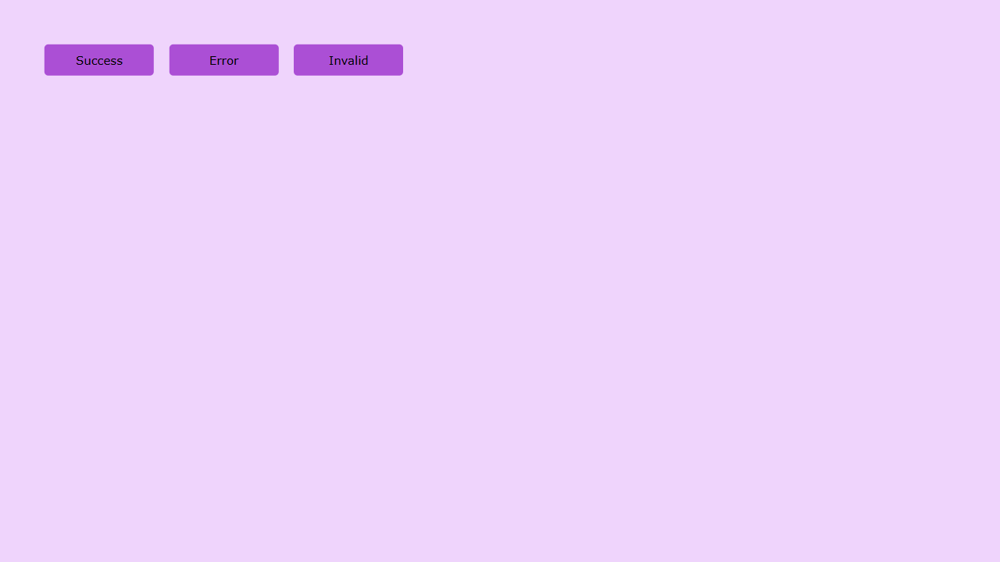

# Toast Message

Toast notifications I built with HTML, CSS and JavaScript while learning animations.

Buttons show success, error and invalid messages that slide in and disappear by themselves.

## Run it locally

Open `index.html` in a browser.
